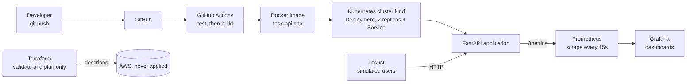

# task-api

A task management REST API built with FastAPI, designed as a DevOps portfolio project. The application logic is intentionally small. The focus is on everything that surrounds it: automated testing, containerization, a CI pipeline, Kubernetes deployment, infrastructure as code, monitoring, and load testing.

The project runs entirely on a local machine and on free tiers. No paid cloud resources are created.

## Architecture



## Features

- Create a task (`POST /tasks`), list tasks (`GET /tasks`), and delete a task (`DELETE /tasks/{task_id}`)
- Input validation: a task title must be between 1 and 100 characters, and new tasks start as not done
- Server-assigned integer ids
- Health check endpoint (`GET /health`), used by the Kubernetes liveness and readiness probes
- Prometheus metrics endpoint (`GET /metrics`), including a request counter labelled by HTTP method and status code
- Thread-safe in-memory storage: a lock protects id assignment and all reads and writes of the store

## Tech stack and the role of each tool

| Technology | Role in this project |
|---|---|
| **Python 3.12** | Programming language of the application and the tests |
| **FastAPI** | Web framework. Defines the endpoints, validates requests, and generates the interactive API docs at `/docs` |
| **Pydantic** | Data validation. Defines the request and response models and enforces the title length rules |
| **Uvicorn** | ASGI server that runs the FastAPI application |
| **pytest** | Test framework for the automated test suite |
| **FastAPI TestClient** | Runs the API in memory during tests, without starting a server |
| **Docker** | Packages the application and its dependencies into a container image |
| **GitHub Actions** | CI pipeline that runs the tests and builds the image on every push and pull request |
| **kind** (Kubernetes in Docker) | Runs a local Kubernetes cluster inside Docker |
| **kubectl** | Command-line tool for interacting with the Kubernetes cluster |
| **Terraform** | Infrastructure as code. Describes an S3 bucket in configuration files |
| **Prometheus** | Collects metrics from the application at regular intervals |
| **Grafana** | Visualizes the Prometheus metrics in dashboards |
| **Locust** | Load testing tool that simulates many users sending requests |

## How the project was built

The project was built in phases. Each phase was completed, tested, and committed before the next one started.

1. **Planning.** Before any code was written, the scope was defined: the endpoints, the data model, the validation rules, the target architecture, and the order of the phases. The plan was documented first.
2. **Application.** A minimal FastAPI application with a health endpoint, and endpoints to create, list, and delete tasks. Endpoints were tested manually through the interactive docs at `/docs`.
3. **Tests.** Nine automated tests covering the health check, creation with valid and invalid titles (empty, missing, 100 characters accepted, 101 rejected), listing, and deletion of existing and non-existing tasks.
4. **Containerization.** A multi-stage Dockerfile: the first stage installs the dependencies, and the final stage contains only the installed packages and the application code. The container runs as a non-root user. A `.dockerignore` file keeps the virtual environment, caches, and tests out of the build context.
5. **Continuous integration.** A GitHub Actions workflow with two jobs. The `build` job depends on the `test` job, so the image is built only when all tests pass.
6. **Kubernetes.** A Deployment with two replicas and a ClusterIP Service. Readiness and liveness probes call `/health`. Resource requests and limits are set for a local environment.
7. **Infrastructure as code.** A Terraform configuration with the AWS provider and one S3 bucket. The provider is configured with placeholder credentials and options that skip all AWS account checks, so the configuration can be validated and planned without contacting AWS. `terraform apply` is never run.
8. **Observability.** A `/metrics` endpoint built with `prometheus-client`. A middleware counts every request by method and status code, and does not count the metrics scrapes themselves. Prometheus scrapes the endpoint, and Grafana displays the request rate.
9. **Load testing.** A Locust scenario in which simulated users create, list, and delete tasks, with weights of 3, 2, and 1 respectively. The dashboard shows the traffic in real time.

AI coding assistants (Cursor and Roo Code) were used to write parts of the code. Every change was reviewed as a diff, verified by running the tests, and explained before it was committed.

## Project structure

```
.
├── app/                    # FastAPI application (main.py)
├── tests/                  # pytest suite (endpoints, validation, metrics)
├── k8s/                    # Kubernetes Deployment and Service manifests
├── terraform/              # Terraform configuration (validation and planning only)
├── monitoring/             # Prometheus scrape configuration
├── load/                   # Locust load test scenario
├── .github/workflows/      # GitHub Actions CI pipeline
├── Dockerfile              # Multi-stage container build
├── .dockerignore           # Files excluded from the Docker build context
├── .gitignore              # Files excluded from version control
├── pytest.ini              # pytest configuration
└── requirements.txt        # Pinned Python dependencies
```

## Getting started

**Requirements:** macOS or Linux, Python 3.12, Git, and Docker Desktop.

```bash
# Clone the repository
git clone https://github.com/<your-username>/PipelineTasks.git
cd PipelineTasks

# Create and activate a virtual environment
python3 -m venv .venv
source .venv/bin/activate

# Install the dependencies
pip install -r requirements.txt

# Start the application with auto-reload
uvicorn app.main:app --reload
```

The API runs at `http://127.0.0.1:8000`. Interactive documentation is available at `http://127.0.0.1:8000/docs`.

Example requests:

```bash
# Create a task
curl -X POST http://127.0.0.1:8000/tasks \
  -H "Content-Type: application/json" \
  -d '{"title": "Learn Kubernetes"}'

# List tasks
curl http://127.0.0.1:8000/tasks

# Delete a task (replace 1 with an existing id)
curl -X DELETE http://127.0.0.1:8000/tasks/1
```

## Running the tests

```bash
source .venv/bin/activate
pytest -q
```

The suite covers the health check, task creation and validation boundaries, listing, deletion (including the 404 case), and the metrics endpoint.

## Running the container

```bash
docker build -t task-api .
docker run -p 8000:8000 task-api
```

Open `http://127.0.0.1:8000/health`. The response should be `{"status": "ok"}`.

## Running on Kubernetes (kind)

**Requirements:** kind and kubectl (`brew install kind kubectl`).

```bash
# Create a local cluster
kind create cluster --name task-api

# Build the image with a fixed version tag
docker build -t task-api:0.1.0 .

# Load the image into the cluster (kind cannot see local Docker images by default)
kind load docker-image task-api:0.1.0 --name task-api

# Apply the manifests
kubectl apply -f k8s/

# Check that both replicas are running
kubectl get pods

# Expose the service locally
kubectl port-forward service/task-api 8080:80
```

With the port-forward running, the service is available at `http://127.0.0.1:8080/health`.

## Monitoring with Prometheus and Grafana

The application exposes metrics at `/metrics`. Prometheus scrapes them every 15 seconds using `monitoring/prometheus.yml`.

Start the application first:

```bash
uvicorn app.main:app
```

Then start Prometheus and Grafana in containers:

```bash
docker run -d --name prometheus -p 9090:9090 \
  -v "$(pwd)/monitoring/prometheus.yml:/etc/prometheus/prometheus.yml" \
  prom/prometheus

docker run -d --name grafana -p 3000:3000 grafana/grafana
```

**Prometheus:** open `http://localhost:9090`, then go to Status → Targets. The `task-api` target should be UP.

**Grafana:** open `http://localhost:3000` and sign in with `admin` / `admin`. Change the password when prompted. Then add a data source:

1. Connections → Data sources → Add data source → Prometheus
2. Set the Prometheus server URL to `http://host.docker.internal:9090`
3. Save & test

`host.docker.internal` is used because Grafana runs inside a container and must reach the Prometheus container through the host.

**Example query** for the request rate per method and status code:

```
rate(http_requests_total{job="task-api"}[1m])
```

The default Grafana credentials must be changed before any real deployment.

To stop and remove the containers:

```bash
docker stop prometheus grafana
docker rm prometheus grafana
```

## Load testing with Locust

Locust is installed in the virtual environment:

```bash
pip install locust
```

With the application running on port 8000:

```bash
locust -f load/locustfile.py --host http://127.0.0.1:8000
```

Open `http://localhost:8089`, set the number of users (10 is enough on a laptop) and the spawn rate (2 per second), and start the test. Watch the request rate change in Grafana while the test runs.

## Infrastructure as code (Terraform)

The `terraform/` folder defines one S3 bucket with `environment` and `project` tags.

```bash
cd terraform
terraform init
terraform validate
terraform plan
```

- `init` downloads the AWS provider into the local `.terraform/` folder, which is excluded from Git.
- `validate` checks the syntax and internal consistency of the configuration.
- `plan` shows what would be created: one S3 bucket. It makes no changes.

The provider is configured with placeholder credentials and options that skip credential validation, account ID lookup, and the metadata API check. The configuration never contacts an AWS account. `terraform apply` is deliberately not part of this project.

## Continuous integration

The workflow in `.github/workflows/ci.yml` runs on every push and pull request:

1. **test:** checks out the code, sets up Python 3.12, installs the dependencies, and runs `pytest -q`.
2. **build:** runs only if `test` succeeds. It builds the Docker image tagged with the commit SHA.

A failing test stops the pipeline before any image is built. Results are visible in the Actions tab of the repository.

## Design decisions

- **In-memory storage.** The application state lives in process memory. This keeps the focus on delivery and operations. A database such as PostgreSQL is the natural next step for a production version.
- **Locking.** Uvicorn handles synchronous routes in a thread pool, so id assignment and access to the shared store are protected by a `threading.Lock`. Without it, two concurrent requests could receive the same id.
- **Non-root container.** The application runs as an unprivileged user, which limits the impact of a compromise.
- **Multi-stage build.** Build-time tools are not included in the final image, which keeps it smaller and reduces its attack surface.
- **Local-first delivery.** Kubernetes runs in kind and monitoring runs in Docker, so the whole pipeline can be reproduced without a cloud account.
- **Validation-only infrastructure.** Terraform is used to describe and validate infrastructure without creating any cloud cost.

## Lessons learned

- **Large files in Git.** An early attempt to push failed with an HTTP 400 error. The cause was the Terraform provider folder (`.terraform/`), which contains binaries of hundreds of megabytes. It was excluded through `.gitignore`, and only the configuration files and the dependency lock file are versioned.
- **Docker bind mounts need files, not folders.** If the host path of a mounted file does not exist, Docker creates a folder with that name, and the mount fails with a "not a directory" error.
- **Metrics need to be created on purpose.** The Prometheus client library exposes process and runtime metrics by default, but application-level metrics such as request counts must be defined in the code.
- **Read the diff before accepting it.** Every AI-generated change was checked, tested, and understood before committing.

## Possible next steps

- Replace the in-memory store with PostgreSQL, running in a container alongside the application
- Push the image to a container registry from the CI pipeline
- Deploy the Kubernetes manifests to a managed cluster
- Add Prometheus alerting rules, for example on the error rate
- Add a Grafana dashboard exported as JSON to the repository, so it can be imported automatically

## License

This project is released under the MIT License. See the `LICENSE` file for details.
